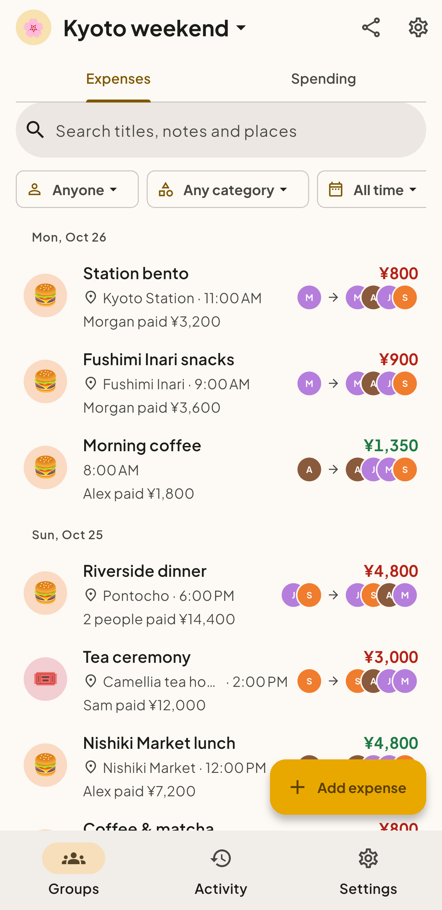
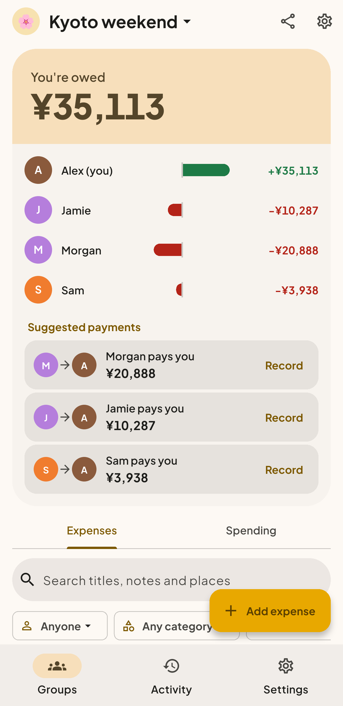
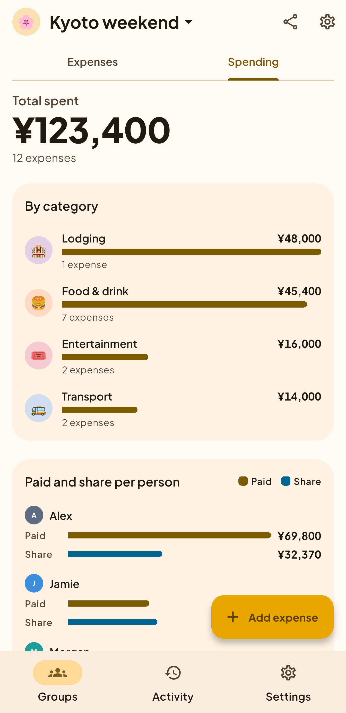

<p align="center">
  
</p>

<h1 align="center">Balnana</h1>

<p align="center"><strong>Split group expenses. Settle up with fewer payments.</strong></p>

<p align="center">Android &amp; web · Self-hosted · AGPL-3.0</p>

Balnana splits shared costs for trips, flatmates and nights out. Share a private
link with your group, record who paid for what, and Balnana works out who owes
whom and the payments that settle everyone up. You run it on your own server.

> Status: early development, preparing the first release.

## A weekend in Kyoto

Four friends, one weekend and ¥123,400 in shared costs. Every purchase is
tracked, every balance is clear, and the statistics show where the money went.

<table>
  <tr>
    <th>Keep track of expenses</th>
    <th>See how to settle up</th>
    <th>Explore your spending</th>
  </tr>
  <tr>
    <td></td>
    <td></td>
    <td></td>
  </tr>
</table>

Screenshots from the Android emulator, with made-up demo data.

## Features

- **Flexible splits.** Split equally, by exact amounts or by shares, with
  several payers per expense. Record refunds and income as well as spending.
- **Simple settling up.** Balnana suggests at most one payment fewer than the
  number of people who owe or are owed, and the same balances always give the
  same suggestions.
- **Exact money.** Amounts are kept in the currency's smallest unit, such as
  cents, never as floating point, so totals always add up.
- **Spending abroad.** Enter an expense in the currency it was paid in, with
  the rate or what it came to on a card statement. Balances stay in the
  group's currency.
- **Links or accounts.** In link mode, a group's private link is all anyone
  needs. In accounts mode, people sign in with a password, Google or any number
  of OpenID Connect providers, and can add or remove them in Settings.
- **Live updates.** Open groups refresh as others add expenses, and phones get
  push notifications over UnifiedPush, with no Firebase SDK in the app.
- **Statistics, receipts and export.** See spending by category, member and
  month, attach receipt photos, and export to CSV.
- **Import from Settle Up.** Bring a group over from its CSV export with the
  balances intact.
- **Yours to run.** One Docker Compose file, a PostgreSQL database and a web
  page for administering the server.

## Quick start

You need Docker with the Compose plugin.

```bash
cp .env.example .env
# Edit .env: set POSTGRES_PASSWORD at least.
docker compose up -d --build
```

Open `http://localhost:8080`. The first visit asks you to choose the
administrator password, so do that right away. Every setting is listed in
[.env.example](.env.example).

## Built with

A Go server (`server/`) backed by PostgreSQL, and a Flutter app (`app/`) for
Android and the web. The API contract between them is `api/openapi.yaml`.

## License

Balnana is free software, licensed under the
[GNU Affero General Public License v3.0](LICENSE) (`AGPL-3.0-only`).

You may run, study, change and share it. If you run a modified version as a
service that others use over a network, you must offer those users the source
code of your version under the same license.
