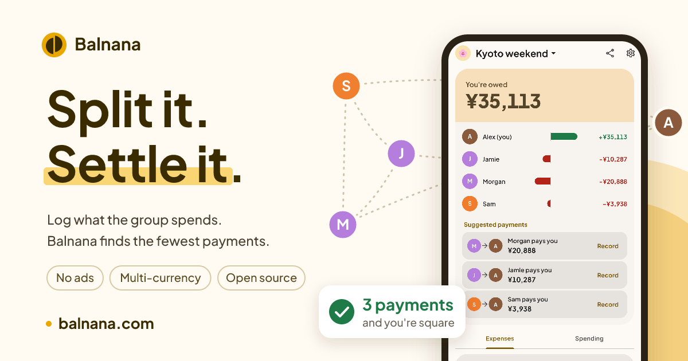
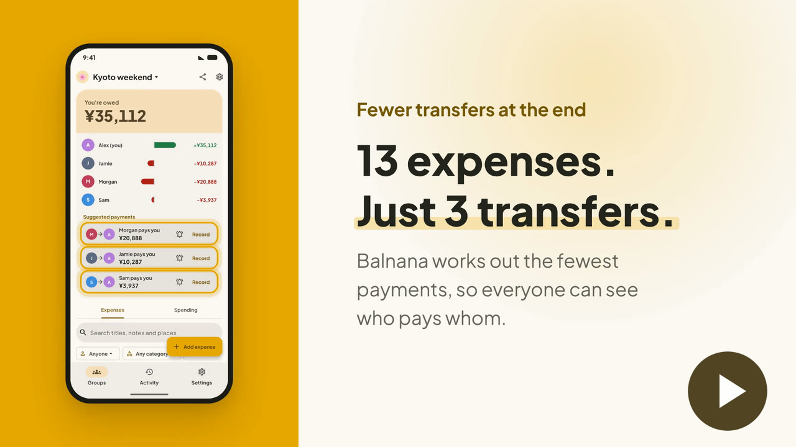
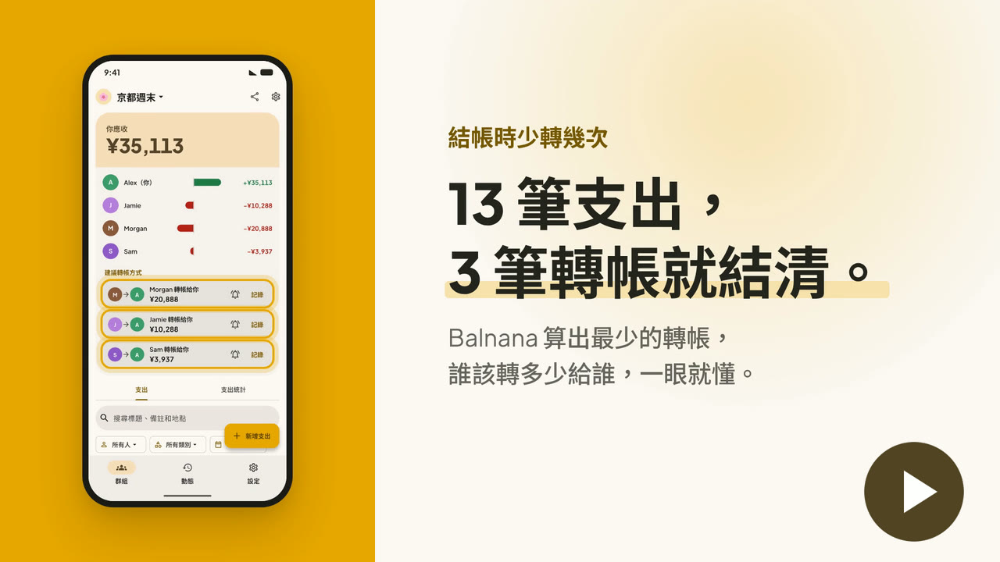
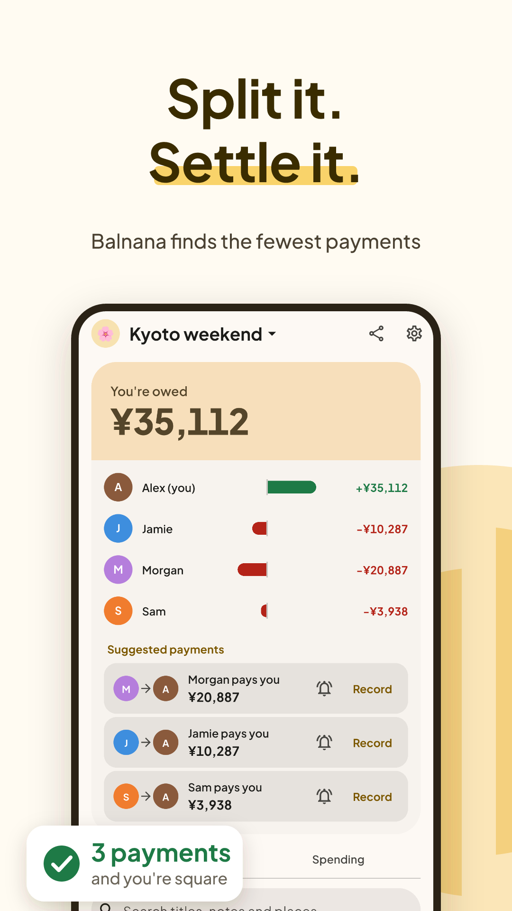
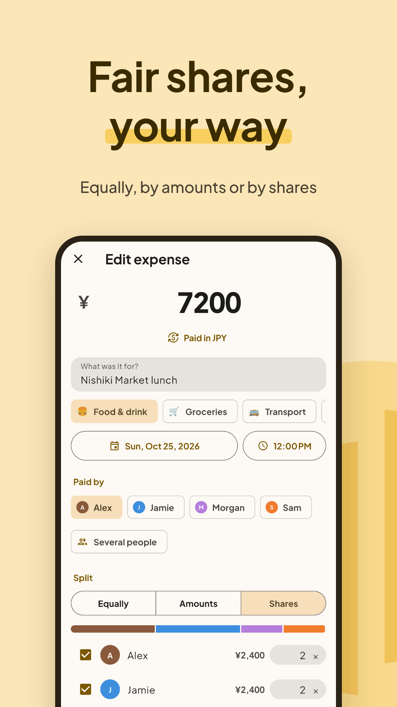
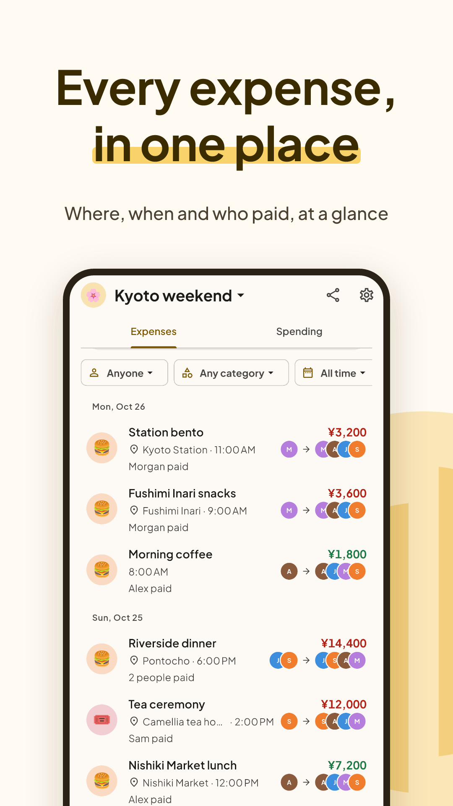
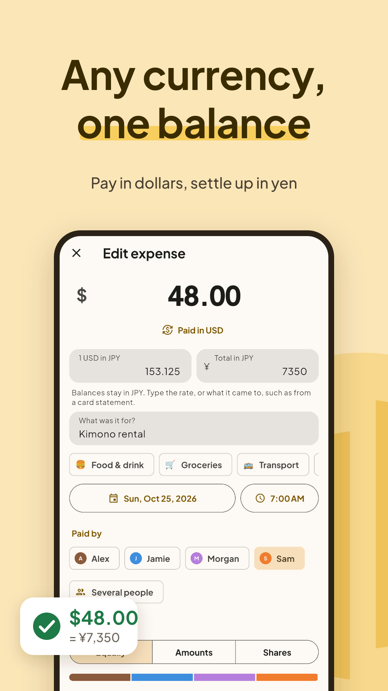
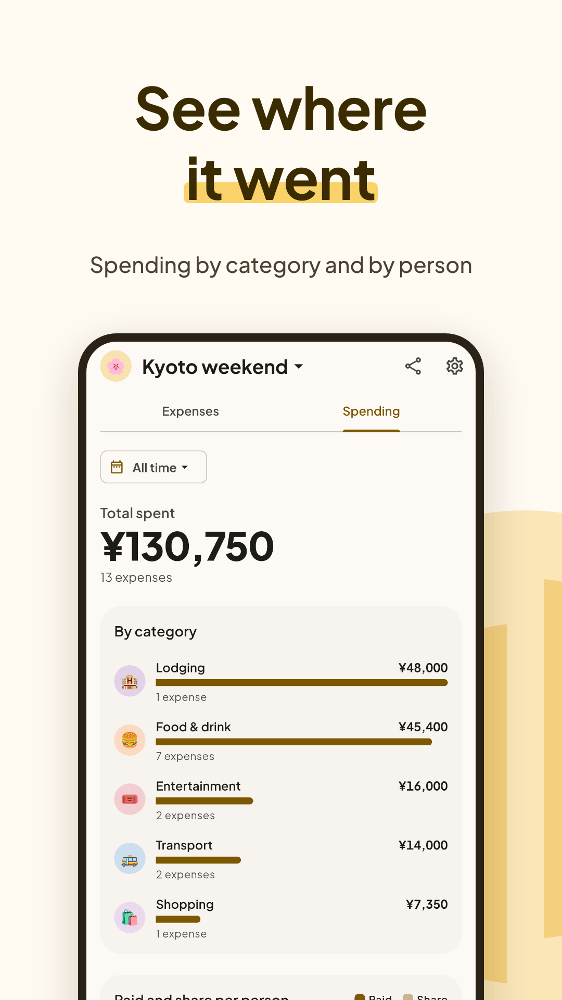
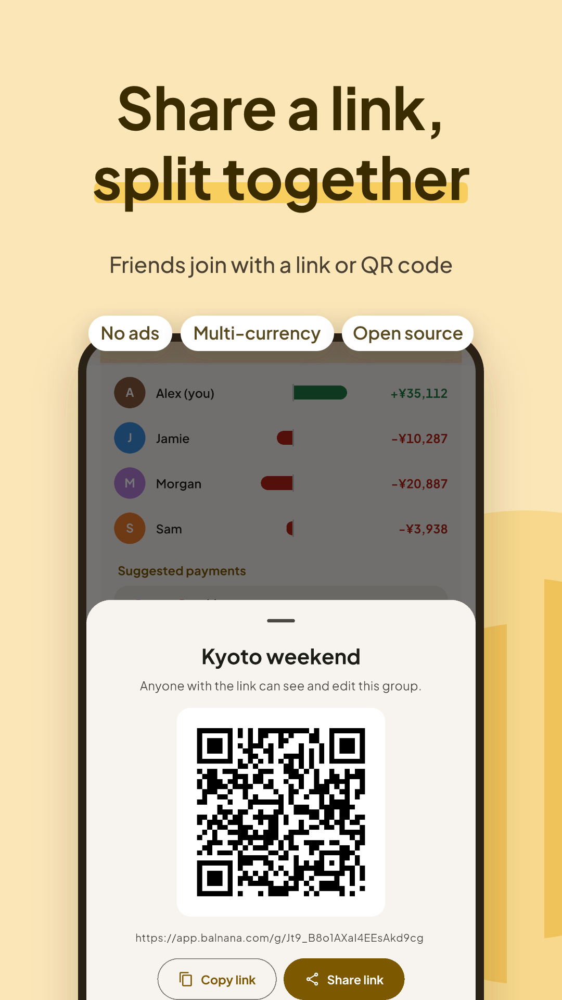

<p align="center">
  <a href="https://balnana.com">
    
  </a>
</p>

<h1 align="center">Balnana</h1>

<p align="center">
  <strong>Split group expenses. Settle up with fewer payments.</strong><br>
  Free and open source. Use the official server, or run your own.
</p>

<p align="center">
  
  
  
  
  <a href="LICENSE"></a>
</p>

<p align="center">
  <a href="https://app.balnana.com"></a>
  <a href="https://balnana.com"></a>
  <a href="https://balnana.com/docs/"></a>
</p>

<p align="center">
  <a href="#watch-the-video">Video</a> ·
  <a href="#a-weekend-in-kyoto">Screenshots</a> ·
  <a href="#features">Features</a> ·
  <a href="#get-started">Get started</a> ·
  <a href="#development">Development</a> ·
  <a href="#license">License</a>
</p>

---

Trips, flatmates, nights out: someone always pays, and someone always has to
work out who owes what. **Balnana does the maths.** Share a private link with
your group, add expenses as they happen, and Balnana tells everyone where they
stand and the few payments that settle it all.

No ads, no tracking, and the source is open for anyone to read.

> [!WARNING]
> **Alpha, pre-release.** Balnana works for everyday use, but it is still
> changing quickly: expect rough edges, and things may move around before the
> first stable release. Google Play and F-Droid releases are on the way.
> Found a bug? [Open an issue](https://github.com/willie6666/balnana/issues).

## Watch the video

<table>
  <tr>
    <td width="50%" align="center">
      <a href="https://youtu.be/Hi_VW6T_hHM"></a>
      <br><sub><b>▶ English</b> · 40 s</sub>
    </td>
    <td width="50%" align="center">
      <a href="https://youtu.be/pkju-vmfZPM"></a>
      <br><sub><b>▶ 繁體中文</b> · 40 秒</sub>
    </td>
  </tr>
</table>

## A weekend in Kyoto

Four friends, three days and ¥130,750 in shared costs, from the guesthouse to
a kimono rental booked in dollars. Here is how that looks in Balnana.

<table>
  <tr>
    <td width="33%"></td>
    <td width="33%"></td>
    <td width="33%"></td>
  </tr>
  <tr>
    <td width="33%"></td>
    <td width="33%"></td>
    <td width="33%"></td>
  </tr>
</table>

<sub>Screenshots from the Android emulator, with made-up demo data.</sub>

## Features

### ⚖️ Split it your way

- **Equally, by exact amounts or by shares**, with several payers on one
  expense when two people put their cards down.
- **Refunds and income** count as well as spending.
- **Recurring expenses** such as rent or subscriptions add themselves on
  schedule.
- **Places and receipts**: pin where an expense happened on a map and attach a
  photo of the receipt.

### 🤝 Settle up with fewer payments

- Balnana suggests **at most one payment fewer than the number of people who
  owe or are owed**, and the same balances always give the same suggestions.
- Record a suggested payment straight from the list once the money has
  changed hands, and the balances update for everyone.

### ✈️ Built for travel

- **Enter an expense in the currency it was paid in.** Type the rate, or what
  it came to on your card statement. Balances stay in the group's currency.
- **Exact money**: amounts are kept in the currency's smallest unit, never as
  floating point, so totals always add up.
- **Works on a bad connection**: saved groups and expenses still open while
  the server is out of reach.

### 🔗 Easy to share

- **Link mode**: a group's private link, or its QR code, is all anyone needs.
  No sign-up.
- **Accounts mode**: sign in with a password, Google or any number of OpenID
  Connect providers.
- **Live updates**: open groups refresh as others add expenses, and phones get
  push notifications over UnifiedPush. On the FOSS build, install a
  UnifiedPush distributor such as ntfy to receive push notifications.

### 📊 Know where the money went

- Spending **by category, by member and by month**.
- **Export to CSV**, and **import from Settle Up** with the balances intact.

### 🏠 Yours to run

- One Docker Compose file, a PostgreSQL database and a web page for
  administering the server.
- Optional plans, if you run a server for others: limits on what it stores,
  with Ko-fi, PayPal or Google Play payments. Off by default.
- A Material 3 app with light and dark themes and, if you like, your
  wallpaper's colors.

## Get started

### Use the official server

Open **[app.balnana.com](https://app.balnana.com)** in your browser, create a
group and share its link. That's it. The Android and iOS apps can connect
to the same server.

### Run your own

You need Docker with the Compose plugin.

```bash
cp .env.example .env
# Edit .env: set POSTGRES_PASSWORD at least.
docker compose up -d --build
```

Open `http://localhost:8080`. On first setup, `/admin` asks for a password
and a setup code. Get the code with `docker compose logs balnana`. Every
setting is listed in [.env.example](.env.example), and the
[documentation](https://balnana.com/docs/) covers running a server.

## Built with

| Part   | Stack                                                    |
|--------|----------------------------------------------------------|
| Server | Go, backed by PostgreSQL (`server/`)                     |
| App    | Flutter, for Android, iOS and the web (`app/`)           |
| API    | One OpenAPI contract between them (`api/openapi.yaml`)   |

## Development

CI records the Go, Flutter and PostgreSQL versions used to verify changes.
See the [CI workflow](.github/workflows/ci.yml).

- In `server/`, point `DATABASE_URL` at a development PostgreSQL instance.
  The test role needs permission to create and drop temporary databases.
  Run `go vet ./...` and `REQUIRE_DB=1 go test -race ./...`.
- In `app/`, run `flutter pub get`, `flutter analyze` and `flutter test`.
  On Linux x64, CI primes SQLite's native library cache with
  `python3 ../.github/scripts/prepare_sqlite.py .` after `flutter pub get`.
- The `foss` Android flavor shows configured PayPal and Ko-fi links by
  default. Build it with `flutter build apk --release --flavor foss`.
  `--dart-define=BALNANA_EXTERNAL_PAYMENTS=false` hides those links. The
  `play` flavor always hides external payment links. The server must also
  have the corresponding payment provider and products configured.
  For flavored payment UI tests, also set
  `--dart-define=BALNANA_TEST_EXTERNAL_PAYMENTS=true` or `false` to specify
  the expected policy independently; see the CI matrix.
- After editing `api/openapi.yaml`, run `go generate ./internal/api` in
  `server/` with the `oapi-codegen` version pinned in CI. After editing
  `app/lib/l10n/*.arb`, run `flutter gen-l10n` in `app/`. If any push
  notification strings changed, also run `dart run tool/push_strings.dart`.

### iOS

Use Xcode with an iOS Simulator runtime and the Flutter version pinned in CI.
The iOS 15+ target uses Swift Package Manager. Run these commands from `app/`.

```bash
flutter pub get
xcrun simctl list devices available
xcrun simctl boot <simulator-id>
flutter run -d <simulator-id>
```

If the active developer directory points at Command Line Tools, select
Xcode with `sudo xcode-select --switch /Applications/Xcode.app/Contents/Developer`.
To see the simulator screen in Xcode 27, open **Xcode > Open Developer
Tool > Device Hub**.

Enter your Balnana server on first launch. The simulator can connect to a
server running on the Mac at `http://127.0.0.1:8080`. Use your Mac's LAN
address or an HTTPS server when testing on an iPhone.

For a physical device, run `flutter build ios --config-only --no-codesign`
from `app/`. Open `app/ios/Runner.xcworkspace`, select a signing team for
Runner, and run the `foss` scheme. External payment links are off by default
on iOS. The iOS target currently covers the core expense flows and uses
the server's existing mobile sign-in callback. Push notifications, home
screen widgets and Google Play Billing are available on Android.

## F-Droid

The [F-Droid build recipe](packaging/fdroid/com.balnana.app.yml) builds an
unsigned FOSS release APK for F-Droid to sign. It builds SQLite from source,
leaves the server address configurable, and disables external payment links.
The [English store listing](fastlane/metadata/android/en-US/) includes the
description, screenshots, and release notes.

<details>
<summary>Submitting a release to F-Droid</summary>

For the first submission, tag the release commit for `1.1.1+3` as `v1.1.1`.
Copy the recipe into an fdroiddata fork as `metadata/com.balnana.app.yml` and
set `Builds[0].commit` to the full commit hash of that tag. Run the following
from the fdroiddata checkout, then open a merge request after its GitLab
pipeline passes.

```sh
fdroid lint com.balnana.app
fdroid build --test --scan-binary com.balnana.app
```

For later releases, increment the version code in `app/pubspec.yaml`, add a
changelog named after that code in `fastlane/metadata/android/en-US/changelogs/`,
and tag the release commit as `v<versionName>`.

</details>

## License

Balnana is free software, licensed under the
[GNU Affero General Public License v3.0](LICENSE) (`AGPL-3.0-only`).

You may run, study, change and share it. If you run a modified version as a
service that others use over a network, you must offer those users the source
code of your version under the same license.

---

<p align="center">
  <a href="https://balnana.com">Website</a> ·
  <a href="https://app.balnana.com">App</a> ·
  <a href="https://balnana.com/docs/">Docs</a>
</p>
