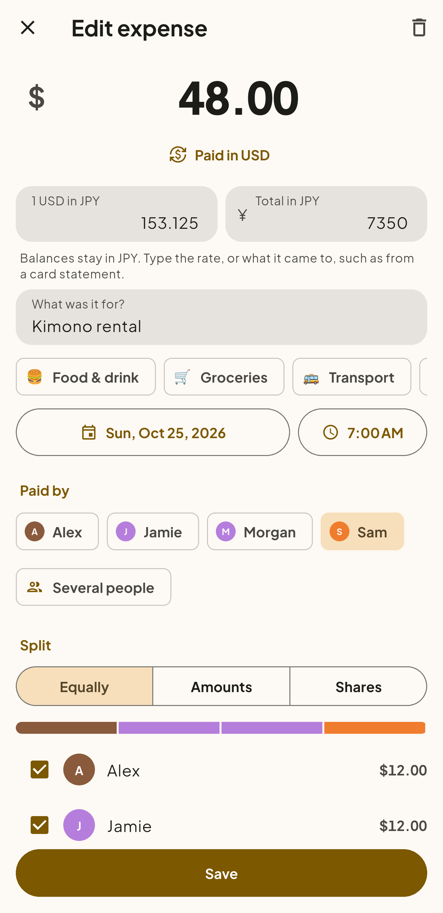

<p align="center">
  
</p>

<h1 align="center">Balnana</h1>

<p align="center">
  <strong>Split group expenses. Settle up with fewer payments.<br>On a server you own.</strong>
</p>

<p align="center">
  
  
  
  <a href="LICENSE"></a>
  
</p>

<p align="center">
  <a href="#quick-start">Quick start</a> ·
  <a href="#features">Features</a> ·
  <a href="#built-with">Built with</a> ·
  <a href="#license">License</a>
</p>

---

Trips, flatmates, nights out: someone always pays, and someone always has to
work out who owes what. **Balnana does the maths.** Share a private link with
your group, add expenses as they happen, and Balnana tells everyone where they
stand and the few payments that settle it all.

No ads, no tracking, no subscription and no one else's cloud. Your group's
money stays on your server.

> **Status:** early development, preparing the first release.

## A weekend in Kyoto

Four friends, three days and ¥130,750 in shared costs, from the guesthouse to
a kimono rental booked in dollars. Here is how that looks in Balnana.

<table>
  <tr>
    <th width="25%">Every expense in one place</th>
    <th width="25%">Who owes whom, at a glance</th>
    <th width="25%">Where the money went</th>
    <th width="25%">Paid abroad? No problem</th>
  </tr>
  <tr>
    <td></td>
    <td></td>
    <td></td>
    <td></td>
  </tr>
</table>

<sub>Screenshots from the Android emulator, with made-up demo data.</sub>

## Features

### Split it your way

- **Equally, by exact amounts or by shares**, with several payers on one
  expense when two people put their cards down.
- **Refunds and income** count as well as spending.
- **Recurring expenses** such as rent or subscriptions add themselves on
  schedule.
- **Places and receipts**: pin where an expense happened on a map and attach a
  photo of the receipt.

### Settle up with fewer payments

- Balnana suggests **at most one payment fewer than the number of people who
  owe or are owed**, and the same balances always give the same suggestions.
- Record a suggested payment straight from the list once the money has
  changed hands, and the balances update for everyone.

### Built for travel

- **Enter an expense in the currency it was paid in.** Type the rate, or what
  it came to on your card statement. Balances stay in the group's currency.
- **Exact money**: amounts are kept in the currency's smallest unit, never as
  floating point, so totals always add up.
- **Works on a bad connection**: saved groups and expenses still open while
  the server is out of reach.

### Easy to share

- **Link mode**: a group's private link, or its QR code, is all anyone needs.
  No sign-up.
- **Accounts mode**: sign in with a password, Google or any number of OpenID
  Connect providers.
- **Live updates**: open groups refresh as others add expenses, and phones get
  push notifications over UnifiedPush, with no Firebase SDK in the app.

### Know where the money went

- Spending **by category, by member and by month**.
- **Export to CSV**, and **import from Settle Up** with the balances intact.

### Yours to run

- One Docker Compose file, a PostgreSQL database and a web page for
  administering the server.
- Optional plans, if you run a server for others: limits on what it stores,
  with Ko-fi payments. Off by default.
- A Material 3 app with light and dark themes and, if you like, your
  wallpaper's colors.

## Quick start

You need Docker with the Compose plugin.

```bash
cp .env.example .env
# Edit .env: set POSTGRES_PASSWORD at least.
docker compose up -d --build
```

Open `http://localhost:8080`. The first visit asks you to choose the
administrator password, so do that right away. Every setting is listed in
[.env.example](.env.example).

## Built with

| Part   | Stack                                                    |
|--------|----------------------------------------------------------|
| Server | Go, backed by PostgreSQL (`server/`)                     |
| App    | Flutter, for Android and the web (`app/`)                |
| API    | One OpenAPI contract between them (`api/openapi.yaml`)   |

## License

Balnana is free software, licensed under the
[GNU Affero General Public License v3.0](LICENSE) (`AGPL-3.0-only`).

You may run, study, change and share it. If you run a modified version as a
service that others use over a network, you must offer those users the source
code of your version under the same license.
